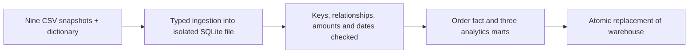

# Indian Ecommerce Analytics Warehouse

A runnable data engineering portfolio project built from the existing **synthetic Indian E-Commerce Customer & Order Intelligence Dataset**. Python and SQLite turn nine related CSV sources into validated analytics tables. No cloud account or third-party Python dependency is needed to run the warehouse.

## Run

Requires Python 3.10 or later. From the repository root:

```sh
python -m ecommerce.pipeline --source tests/fixtures --target output/ecommerce.sqlite
python -m unittest discover -s tests -v
```

The fixture is a small relationally consistent subset of the synthetic dataset. To use the original local dataset:

```sh
python -m ecommerce.pipeline --source dataset_for_project --target output/ecommerce.sqlite
```

To regenerate the full synthetic dataset, install the generator dependencies separately and run:

```sh
pip install -r tools/requirements-generator.txt
python tools/generate_dataset.py
python -m ecommerce.pipeline --source tools/data --target output/ecommerce.sqlite
```

## Architecture



The sources cover customers, products, orders, order items, payments, shipments, returns, reviews and campaigns. The full local dataset spans 2023–2025. All people and transactions are fabricated; this project makes no claims about an actual business.

## Data contracts and metrics

The source dictionary documents column types and nullability. Ingestion rejects missing or extra columns, malformed rows, invalid numeric/date values, required nulls and duplicate primary keys. Each source has one row per named entity ID; payments and shipments also have at most one row per order. All populated customer, product, order and campaign references must resolve. The nullable campaign reference is allowed.

Order subtotal must reconcile to line revenue, and final amount to subtotal plus shipping plus tax, within INR 0.50. Quantities must be positive; payment refunds must lie between zero and the order amount; shipment delivery dates cannot precede dispatch. These are explicit implemented checks, not a claim that every business rule is covered.

| Table | Grain | Purpose |
|---|---|---|
| `fact_orders` | Order ID | Order attributes, aggregated line metrics, payment/refund totals, delivery flag and return record count |
| `mart_daily_sales` | Calendar order date | Order count, units, gross ordered value and net collected |
| `mart_customer_value` | Customer ID | Customer order count, last order date and net collected |
| `mart_product_sales` | Product ID | Ordered units, merchandise value and merchandise profit |

Amounts are INR. `gross_ordered_value` includes all order statuses and is not recognized revenue. `net_collected` is payment amount paid minus payment refund amount; refunds from the returns table are not subtracted again. Daily net collection is attributed to **order date**, not settlement date. Product metrics include all statuses and do not allocate refunds. Children are aggregated before joining so multiple items or returns do not inflate order totals. Returns have no order-item ID in the actual source, so no exact line-level return match is invented.

Dates are source calendar dates; no timezone conversion is applied. SQLite REAL is suitable for this educational analysis, not a financial ledger requiring exact decimal accounting. Historical customer aggregate columns may leak future information and are not appropriate as predictive features without point-in-time reconstruction.

## Operations and recovery

This is a full-snapshot batch pipeline, not CDC or streaming. Each successful run replaces the entire warehouse, so source updates and deletes are reflected on replay. Identical inputs produce identical business tables; run timestamps change. Schedule one writer at a time and keep inputs immutable for the run. No freshness SLA is asserted for this static historical dataset.

The pipeline writes to a temporary database beside the target, validates it, then atomically replaces the target. Failed validation leaves the previous target unchanged. Failures return a nonzero exit status with the table/line or failed rule; fix the snapshot and rerun. Copy the existing database before a successful replacement if historical rollback is required. Consumers should reopen connections after replacement. No automatic retries or concurrent-writer coordination are implemented.

`pipeline_run` stores source row counts, SHA-256 hashes, check results and UTC timestamps. The same report is printed as JSON. The portfolio maintainer owns these contracts; changes to source schema require an explicit dictionary and pipeline review. This is a local portfolio implementation, not a deployed production service.

## Verification

Tests cover replay, order-grain and payment reconciliation, invalid numeric values, duplicate keys, orphan references, incorrect totals, missing files and preservation of the prior database on failure. GitHub Actions runs the tests and sample pipeline. See `docs/verification.md` for the measured full-dataset run.
